# Écrans de démarrage et de setup

Pour chaque ROM de la bibliothèque : l'écran affiché à la mise sous tension (POST) et, quand
le BIOS en a un, son écran de configuration (setup). Les machines sont démarrées sans disque
ni disquette : le démarrage s'achève donc sur un message d'amorçage ou d'absence de système.
Cliquer sur une image pour l'afficher en grand. Les noms de fichiers reprennent ceux des ROM
de [bios/](../bios/).

Les écrans ont été produits sur ordinateur, à partir des ROM ; ce ne sont pas des photos de
machines. Ils montrent fidèlement les textes, la mise en page et les menus de chaque version.

Sur quelques écrans, la machine démarrait sans configuration enregistrée et sans son clavier
ni ses circuits d'origine. Des messages comme `<Bad CMOS checksum>`, `<Bad CMOS floppy type>`,
`<Keyboard error>`, `<Bad A20 line>`, `<Bad keyboard power>`, `Clock: ???` ou
`Installed memory: 0 Kbytes` en découlent : ils ne signalent pas une ROM défectueuse. Le BIOS
pose alors la question « System setup (Y/N) ? ».

## BIOS des PC Goupil

### Club

| BIOS | Démarrage | Setup |
|---|---|---|
| Goupil Club - G4MON-88 V1R1 `CLUB1_U45B.BIN` | <a href="Club/CLUB1_U45B_demarrage.png">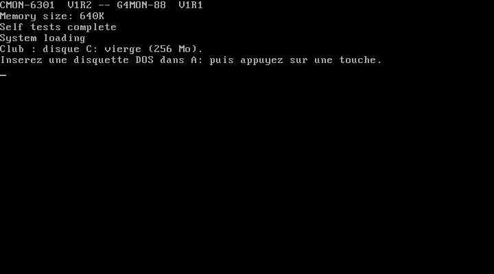</a> | — |

### G4

| BIOS | Démarrage | Setup |
|---|---|---|
| G4 V1 - G4MON-186 V1R4 `CPU.4.1.11J-D.BIN` + `CPU.4.1.12J-D.BIN` |  | — |
| G4 V2 - G4MON-186 V2R4 `CPU.4.2.7Q-D_G4_V2.BIN` + `CPU.4.2.7S-D_G4_V2.BIN` | <a href="G4/CPU.4.2.7Q-D_G4_V2+CPU.4.2.7S-D_G4_V2_demarrage.png">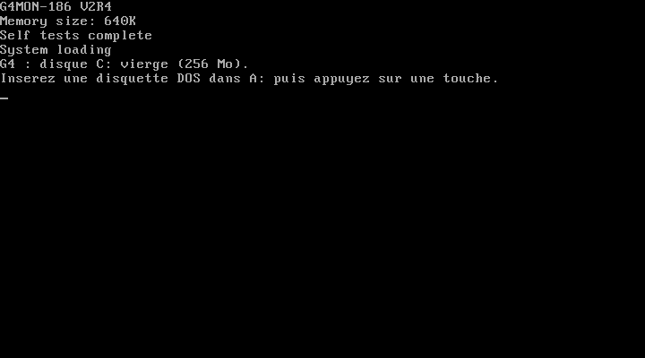</a> | — |
| G4 V2 - G4MON-186 V3R1 `CPU.4.2.7Q-E.BIN` + `CPU.4.2.7S-E.BIN` | <a href="G4/CPU.4.2.7Q-E+CPU.4.2.7S-E_demarrage.png">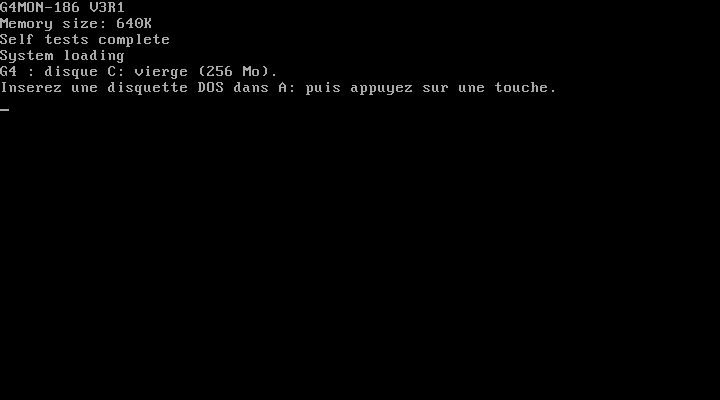</a> | — |

### G40

| BIOS | Démarrage | Setup |
|---|---|---|
| G40 V1 - G4MON-286 V1R3 `CPU40.1.2K-C_G40_V1.BIN` + `CPU40.1.5J-C_G40_V1.BIN` | <a href="G40/CPU40.1.5J-C_G40_V1+CPU40.1.2K-C_G40_V1_demarrage.png">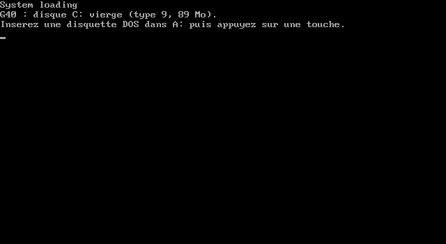</a> | <a href="G40/CPU40.1.5J-C_G40_V1+CPU40.1.2K-C_G40_V1_setup.png">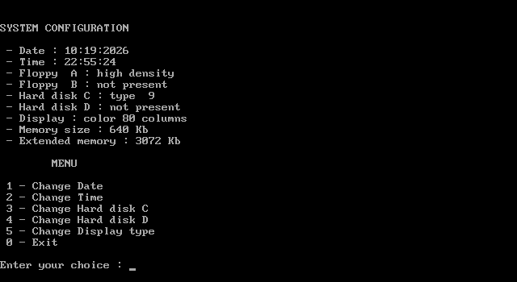</a> |
| G40 V1/V2 - G4MON-286 V2R5 `PGM-C40.2.2K-J_G40_V1_V2.BIN` + `PGM-C40.2.5J-J_G40_V1_V2.BIN` | <a href="G40/PGM-C40.2.5J-J_G40_V1_V2+PGM-C40.2.2K-J_G40_V1_V2_demarrage.png">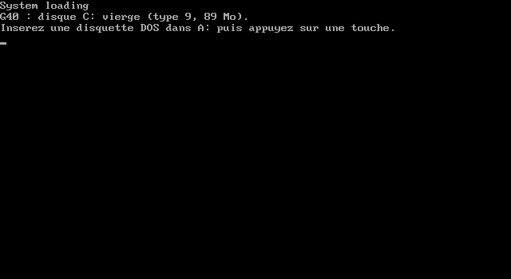</a> | <a href="G40/PGM-C40.2.5J-J_G40_V1_V2+PGM-C40.2.2K-J_G40_V1_V2_setup.png">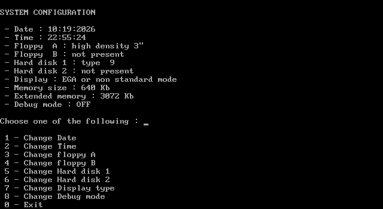</a> |

### G5 S86

| BIOS | Démarrage | Setup |
|---|---|---|
| G5 S86 V1 EGA - G5MON-86 V1R3 `MSG5.7F-C.BIN` + `MSG5.9F-C.BIN` | <a href="G5/S86/MSG5.7F-C+MSG5.9F-C_demarrage.png">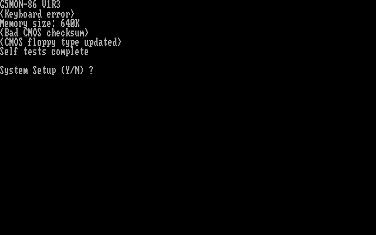</a> | — |
| G5 S86 V2 VGA - G5MON-86 V2R3 `MSG5.2.5E-B.BIN` + `MSG5.2.6E-B.BIN` | <a href="G5/S86/MSG5.2.5E-B+MSG5.2.6E-B_demarrage.png">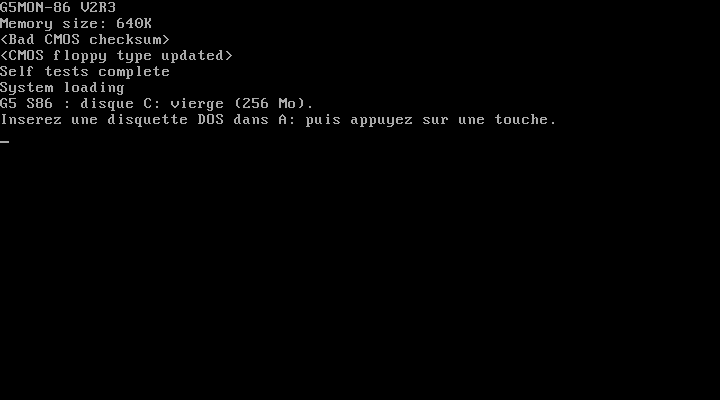</a> | <a href="G5/S86/MSG5.2.5E-B+MSG5.2.6E-B_setup.png">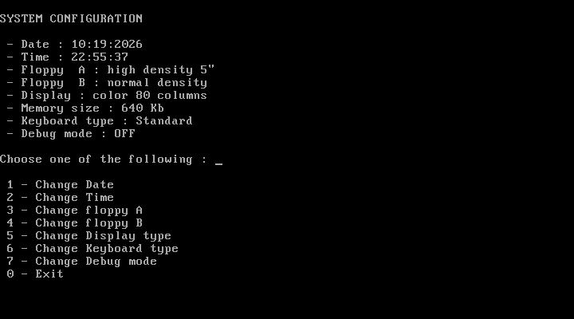</a> |

### G5 286

| BIOS | Démarrage | Setup |
|---|---|---|
| G5 286 V1 EGA - G5MON-286 V1R2 `M2G5.1.3L-B.BIN` + `M2G5.1.4L-B.BIN` | <a href="G5/286/M2G5.1.3L-B+M2G5.1.4L-B_demarrage.png">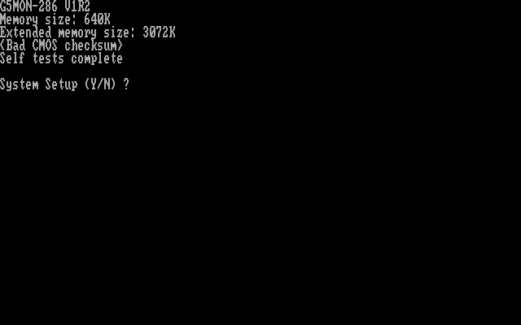</a> | <a href="G5/286/setup/M2G5.1.3L-B+M2G5.1.4L-B_menu.png">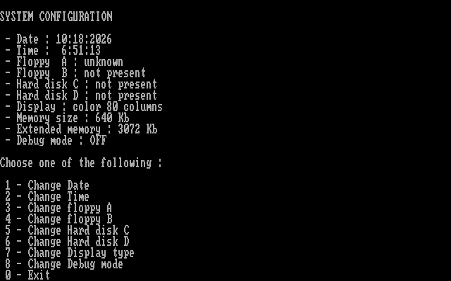</a>  [débogueur](G5/286/setup/M2G5.1.3L-B+M2G5.1.4L-B_debug.png) · [disque dur](G5/286/setup/M2G5.1.3L-B+M2G5.1.4L-B_disque.png) · [disquette](G5/286/setup/M2G5.1.3L-B+M2G5.1.4L-B_disquette.png) · [type d'écran](G5/286/setup/M2G5.1.3L-B+M2G5.1.4L-B_ecran.png) |
| G5 286 V1 - G5MON-286 V1R4.2 `G5286EV_V1R2.4.BIN` + `G5286OD_V1R2.4.BIN` | <a href="G5/286/G5286EV_V1R2.4+G5286OD_V1R2.4_demarrage.png">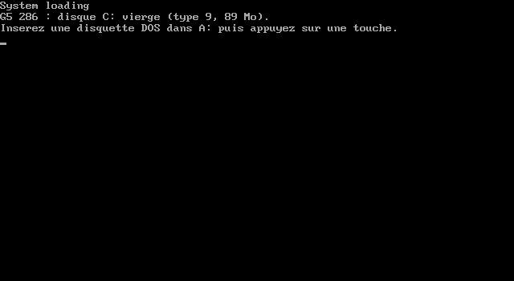</a> | <a href="G5/286/G5286EV_V1R2.4+G5286OD_V1R2.4_setup.png">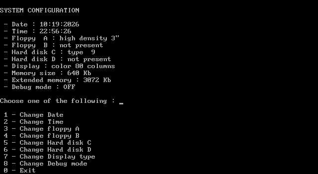</a>  [débogueur](G5/286/setup/G5286EV_V1R2.4+G5286OD_V1R2.4_debug.png) · [disque dur](G5/286/setup/G5286EV_V1R2.4+G5286OD_V1R2.4_disque.png) · [disquette](G5/286/setup/G5286EV_V1R2.4+G5286OD_V1R2.4_disquette.png) · [type d'écran](G5/286/setup/G5286EV_V1R2.4+G5286OD_V1R2.4_ecran.png) · [menu](G5/286/setup/G5286EV_V1R2.4+G5286OD_V1R2.4_menu.png) |
| G5 286 V1 EGA - G5MON-286 V1R5 `M2G5.1.3L-D.BIN` + `M2G5.1.4L-D.BIN` | <a href="G5/286/M2G5.1.3L-D+M2G5.1.4L-D_demarrage.png">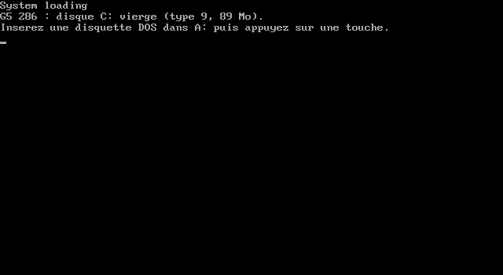</a> |   [débogueur](G5/286/setup/M2G5.1.3L-D+M2G5.1.4L-D_debug.png) · [disque dur](G5/286/setup/M2G5.1.3L-D+M2G5.1.4L-D_disque.png) · [disquette](G5/286/setup/M2G5.1.3L-D+M2G5.1.4L-D_disquette.png) · [type d'écran](G5/286/setup/M2G5.1.3L-D+M2G5.1.4L-D_ecran.png) · [menu](G5/286/setup/M2G5.1.3L-D+M2G5.1.4L-D_menu.png) |
| G5 286 V2 EGA - G5MON-286 V2R4 `M2G5.2.3B-A.BIN` + `M2G5.2.4B-A.BIN` |  |   [débogueur](G5/286/setup/M2G5.2.3B-A+M2G5.2.4B-A_debug.png) · [disque dur](G5/286/setup/M2G5.2.3B-A+M2G5.2.4B-A_disque.png) · [disquette](G5/286/setup/M2G5.2.3B-A+M2G5.2.4B-A_disquette.png) · [type d'écran](G5/286/setup/M2G5.2.3B-A+M2G5.2.4B-A_ecran.png) · [menu](G5/286/setup/M2G5.2.3B-A+M2G5.2.4B-A_menu.png) |
| G5 286 V2 EGA - G5MON-286 V2R5 `M2G5.2.3B-B.BIN` + `M2G5.2.4B-B.BIN` | <a href="G5/286/M2G5.2.3B-B+M2G5.2.4B-B_demarrage.png">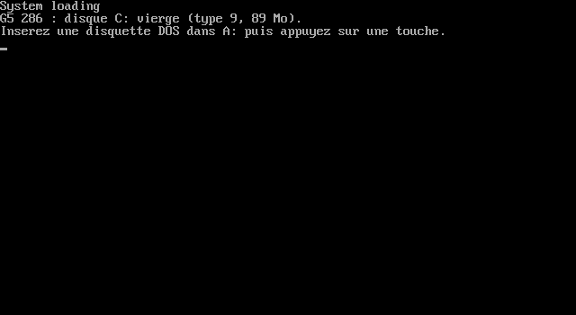</a> |   [débogueur](G5/286/setup/M2G5.2.3B-B+M2G5.2.4B-B_debug.png) · [disque dur](G5/286/setup/M2G5.2.3B-B+M2G5.2.4B-B_disque.png) · [disquette](G5/286/setup/M2G5.2.3B-B+M2G5.2.4B-B_disquette.png) · [type d'écran](G5/286/setup/M2G5.2.3B-B+M2G5.2.4B-B_ecran.png) · [menu](G5/286/setup/M2G5.2.3B-B+M2G5.2.4B-B_menu.png) |
| G5 286 V3 VGA - G5MON-286 V3R5 `M2G5.2.3B-1.BIN` + `M2G5.2.4B-1.BIN` | <a href="G5/286/M2G5.2.3B-1+M2G5.2.4B-1_demarrage.png">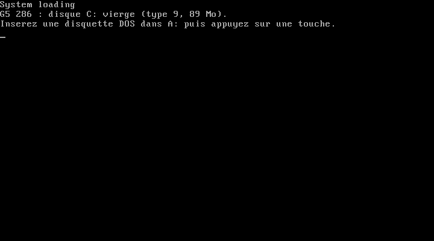</a> | <a href="G5/286/M2G5.2.3B-1+M2G5.2.4B-1_setup.png">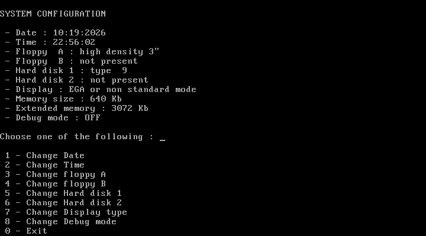</a>  [débogueur](G5/286/setup/M2G5.2.3B-1+M2G5.2.4B-1_debug.png) · [disque dur](G5/286/setup/M2G5.2.3B-1+M2G5.2.4B-1_disque.png) · [disquette](G5/286/setup/M2G5.2.3B-1+M2G5.2.4B-1_disquette.png) · [type d'écran](G5/286/setup/M2G5.2.3B-1+M2G5.2.4B-1_ecran.png) · [menu](G5/286/setup/M2G5.2.3B-1+M2G5.2.4B-1_menu.png) |
| G5 286 V3 VGA - G5MON-286 V3R6 `M2G5.3.3B-A.BIN` + `M2G5.3.4B-A.BIN` | <a href="G5/286/M2G5.3.3B-A+M2G5.3.4B-A_demarrage.png">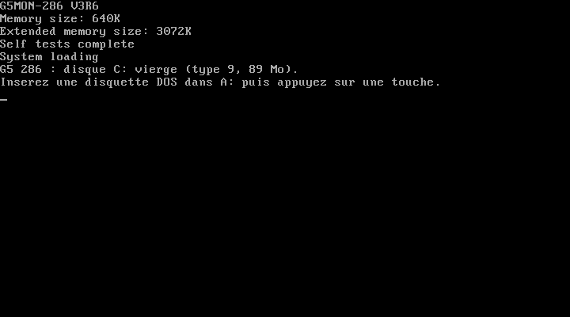</a> | <a href="G5/286/M2G5.3.3B-A+M2G5.3.4B-A_setup.png">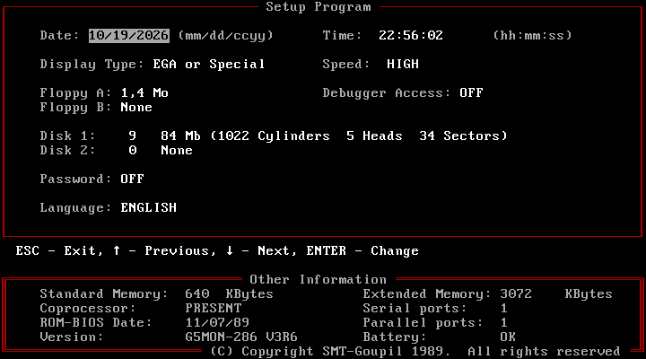</a>  [autre langue](G5/286/setup/M2G5.3.3B-A+M2G5.3.4B-A_langue.png) |
| G5 286 V3 VGA - G5MON-286 V3R7 `M2G5.3.3B-C.BIN` + `M2G5.3.4B-C.BIN` | <a href="G5/286/M2G5.3.3B-C+M2G5.3.4B-C_demarrage.png">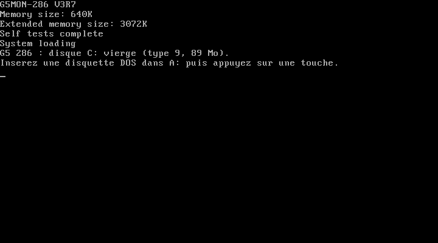</a> | <a href="G5/286/M2G5.3.3B-C+M2G5.3.4B-C_setup.png">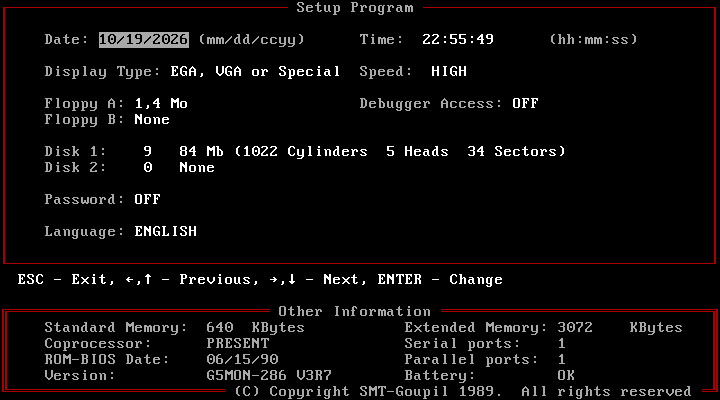</a>  [autre langue](G5/286/setup/M2G5.3.3B-C+M2G5.3.4B-C_langue.png) |
| G5 286 V4 VGA - G5MON-286 V4R7 `M2G5.4.4A-C.BIN` + `M2G5.4.5A-C.BIN` |  | <a href="G5/286/M2G5.4.4A-C+M2G5.4.5A-C_setup.png">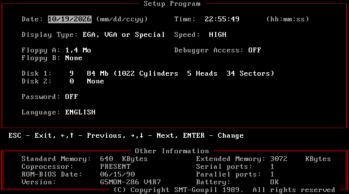</a>  [autre langue](G5/286/setup/M2G5.4.4A-C+M2G5.4.5A-C_langue.png) |

### G5 386

| BIOS | Démarrage | Setup |
|---|---|---|
| G5 386 V1 EGA - G5MON-386 V1R4 `M3G5.1.3M-C.BIN` + `M3G5.1.5M-C.BIN` |  |   [débogueur](G5/386/setup/M3G5.1.3M-C+M3G5.1.5M-C_debug.png) · [disque dur](G5/386/setup/M3G5.1.3M-C+M3G5.1.5M-C_disque.png) · [disquette](G5/386/setup/M3G5.1.3M-C+M3G5.1.5M-C_disquette.png) · [type d'écran](G5/386/setup/M3G5.1.3M-C+M3G5.1.5M-C_ecran.png) · [menu](G5/386/setup/M3G5.1.3M-C+M3G5.1.5M-C_menu.png) |
| G5 386 V1 EGA - G5MON-386 V1R7 `M3G5.1.3M-E.BIN` + `M3G5.1.5M-E.BIN` | <a href="G5/386/M3G5.1.3M-E+M3G5.1.5M-E_demarrage.png">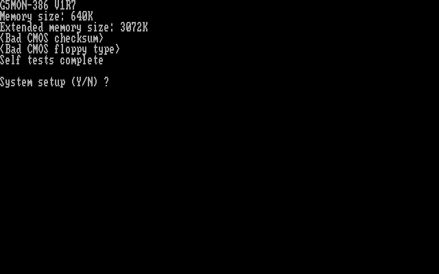</a> | <a href="G5/386/setup/M3G5.1.3M-E+M3G5.1.5M-E_principal.png">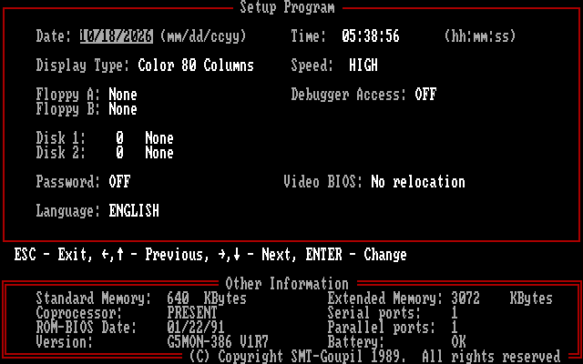</a>  [autre langue](G5/386/setup/M3G5.1.3M-E+M3G5.1.5M-E_langue.png) |
| G5 386 V2 VGA - G5MON-386 V2R6 `M3G5.2.3M-E.BIN` + `M3G5.2.5M-E.BIN` |  | <a href="G5/386/M3G5.2.3M-E+M3G5.2.5M-E_setup.png">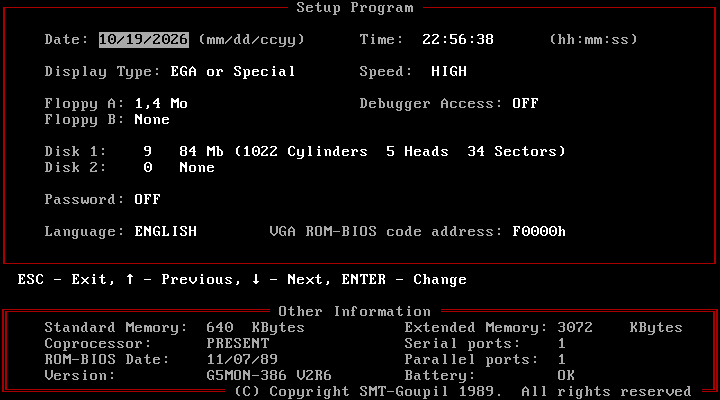</a>  [autre langue](G5/386/setup/M3G5.2.3M-E+M3G5.2.5M-E_langue.png) |

### G5 386DX

| BIOS | Démarrage | Setup |
|---|---|---|
| G5 386 DX - V1R7 `M3DX.1A-C.BIN` + `M3DX.3A-C.BIN` | <a href="G5/386DX/M3DX.1A-C+M3DX.3A-C_demarrage.png">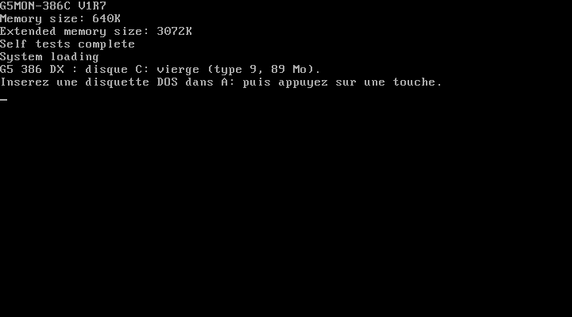</a> | <a href="G5/386DX/M3DX.1A-C+M3DX.3A-C_setup.png">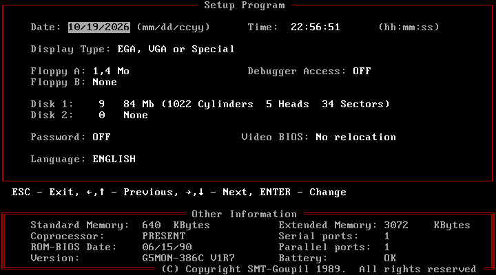</a>  [autre langue](G5/386DX/setup/M3DX.1A-C+M3DX.3A-C_langue.png) |

### G5 SX

| BIOS | Démarrage | Setup |
|---|---|---|
| G5 SX - V1R7 `MG5SX.1.2G-C.BIN` | <a href="G5/SX/MG5SX.1.2G-C_demarrage.png">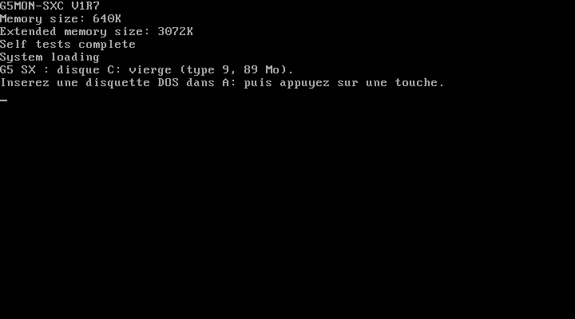</a> | <a href="G5/SX/MG5SX.1.2G-C_setup.png">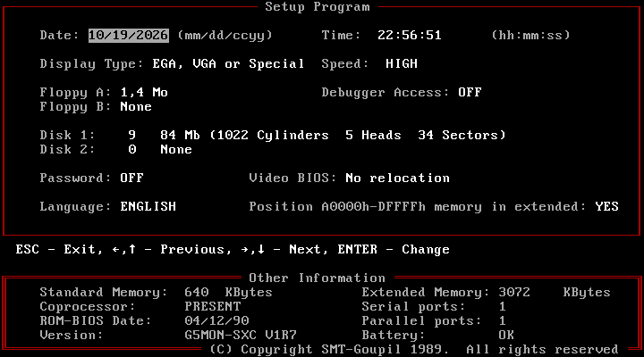</a>  [autre langue](G5/SX/setup/MG5SX.1.2G-C_langue.png) |

### G5 G286E (Normerel)

| BIOS | Démarrage | Setup |
|---|---|---|
| G286E Normerel, indice A `G286E_IC9-A.BIN` + `G286E_IC10-A.BIN` | dump incomplet : ne démarre pas (voir le catalogue) | — |
| G286E Normerel V3.05 `G286E_V3.05.IC9-F.BIN` + `G286E_V3.05.IC10-F.BIN` | dump incomplet : ne démarre pas (voir le catalogue) | — |
| ISA16-B R3.4 (carte Normerel du G286E) `ISA_16B_R3.4.IC9.BIN` + `ISA_16B_R3.4.IC10.BIN` | <a href="G5/G286E-Normerel/ISA_16B_R3.4.IC9+ISA_16B_R3.4.IC10_demarrage.png">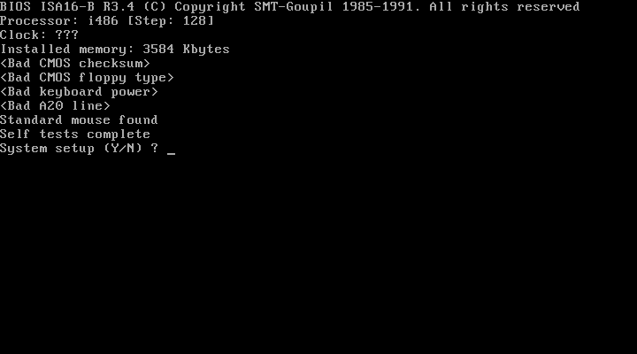</a> | <a href="G5/G286E-Normerel/setup/ISA_16B_R3.4.IC9+ISA_16B_R3.4.IC10_principal.png">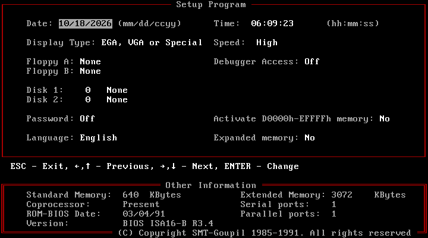</a>  [autre langue](G5/G286E-Normerel/setup/ISA_16B_R3.4.IC9+ISA_16B_R3.4.IC10_langue.png) |

### G50

| BIOS | Démarrage | Setup |
|---|---|---|
| G50 V1 EGA - G50MON-386 V1R5 `M5.1.12P-B.BIN` + `M5.1.12N-B.BIN` | <a href="G50/M5.1.12P-B+M5.1.12N-B_demarrage.png">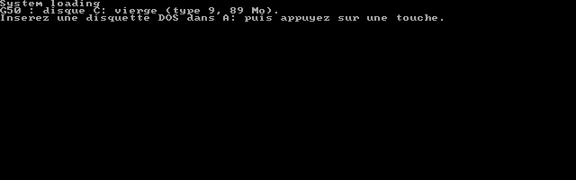</a> | <a href="G50/M5.1.12P-B+M5.1.12N-B_setup.png">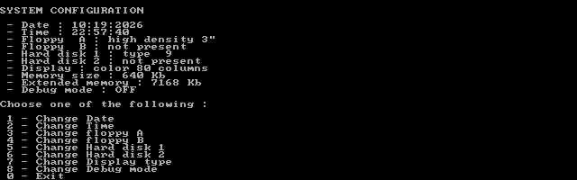</a>  [débogueur](G50/setup/M5.1.12P-B+M5.1.12N-B_debug.png) · [disque dur](G50/setup/M5.1.12P-B+M5.1.12N-B_disque.png) · [disquette](G50/setup/M5.1.12P-B+M5.1.12N-B_disquette.png) · [type d'écran](G50/setup/M5.1.12P-B+M5.1.12N-B_ecran.png) · [menu](G50/setup/M5.1.12P-B+M5.1.12N-B_menu.png) |
| G50 V1 EGA - G50MON-386 V1R5B `M5.1.12P-C_G50_V1R5B.BIN` + `M5.1.12N-C_G50_V1R5B.BIN` |  |   [débogueur](G50/setup/M5.1.12P-C_G50_V1R5B+M5.1.12N-C_G50_V1R5B_debug.png) · [disque dur](G50/setup/M5.1.12P-C_G50_V1R5B+M5.1.12N-C_G50_V1R5B_disque.png) · [disquette](G50/setup/M5.1.12P-C_G50_V1R5B+M5.1.12N-C_G50_V1R5B_disquette.png) · [type d'écran](G50/setup/M5.1.12P-C_G50_V1R5B+M5.1.12N-C_G50_V1R5B_ecran.png) · [menu](G50/setup/M5.1.12P-C_G50_V1R5B+M5.1.12N-C_G50_V1R5B_menu.png) |
| G50 V2 VGA - G50MON-386 V2R5 `G50_V2R5_M5.2.12P-A.BIN` + `G50_V2R5_M5.2.12N-A.BIN` |  |   [débogueur](G50/setup/G50_V2R5_M5.2.12P-A+G50_V2R5_M5.2.12N-A_debug.png) · [disque dur](G50/setup/G50_V2R5_M5.2.12P-A+G50_V2R5_M5.2.12N-A_disque.png) · [disquette](G50/setup/G50_V2R5_M5.2.12P-A+G50_V2R5_M5.2.12N-A_disquette.png) · [type d'écran](G50/setup/G50_V2R5_M5.2.12P-A+G50_V2R5_M5.2.12N-A_ecran.png) · [menu](G50/setup/G50_V2R5_M5.2.12P-A+G50_V2R5_M5.2.12N-A_menu.png) |
| G50 V2 VGA - G50MON-386 V2R6 `G50_V2R6_M5.1.12P-D.BIN` + `G50_V2R6_M5.1.12N-D.BIN` | <a href="G50/G50_V2R6_M5.1.12P-D+G50_V2R6_M5.1.12N-D_demarrage.png">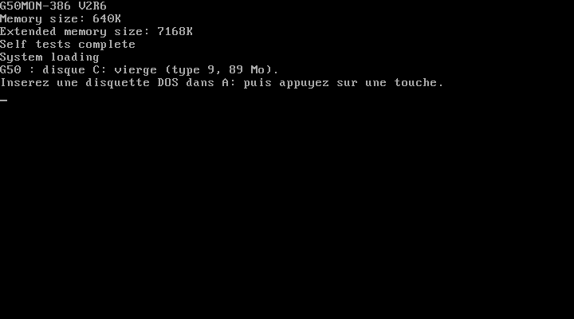</a> |   [autre langue](G50/setup/G50_V2R6_M5.1.12P-D+G50_V2R6_M5.1.12N-D_langue.png) |
| G50 V2 VGA - G50MON-386 V2R6B `G50_V2R6B_M5.2.12P-C.BIN` + `G50_V2R6B_M5.2.12N-C.BIN` | <a href="G50/G50_V2R6B_M5.2.12P-C+G50_V2R6B_M5.2.12N-C_demarrage.png">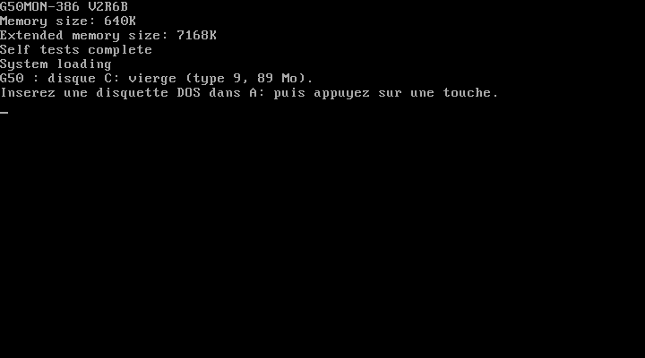</a> | <a href="G50/G50_V2R6B_M5.2.12P-C+G50_V2R6B_M5.2.12N-C_setup.png">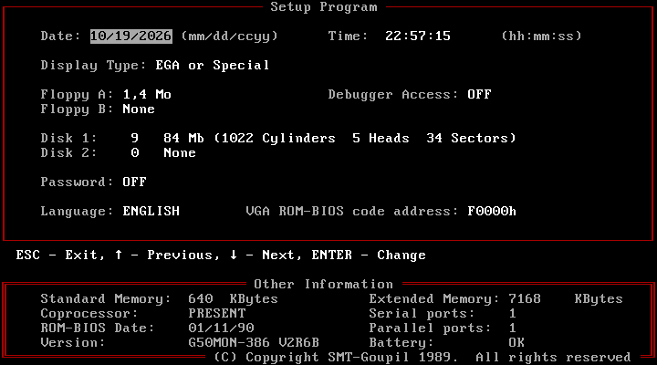</a>  [autre langue](G50/setup/G50_V2R6B_M5.2.12P-C+G50_V2R6B_M5.2.12N-C_langue.png) |
| G50 V2 DX VGA - G50MON-386 V2R7 `M5.2.12P-E_G50_V2R7.BIN` + `M5.2.12N-E_G50_V2R7.BIN` |  | <a href="G50/M5.2.12P-E_G50_V2R7+M5.2.12N-E_G50_V2R7_setup.png">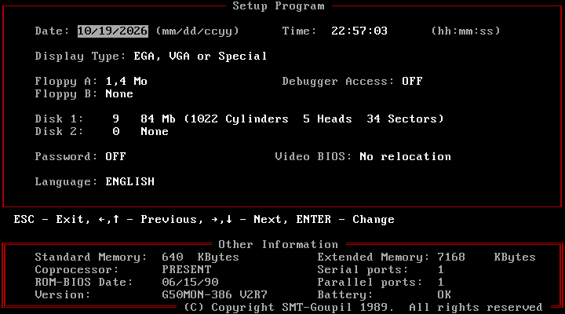</a>  [autre langue](G50/setup/M5.2.12P-E_G50_V2R7+M5.2.12N-E_G50_V2R7_langue.png) |
| G50 V2R7 modifié disque 500 Mo `G50_12P_V2R7_DD500Mo.BIN` + `G50_12N_V2R7_DD500Mo.BIN` | <a href="G50/G50_12P_V2R7_DD500Mo+G50_12N_V2R7_DD500Mo_demarrage.png">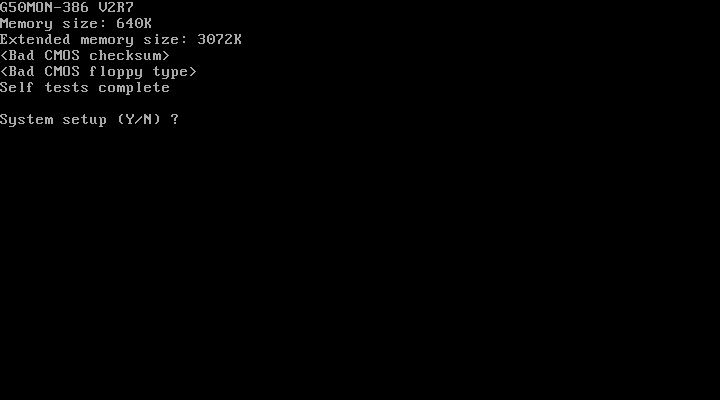</a> | <a href="G50/setup/G50_12P_V2R7_DD500Mo+G50_12N_V2R7_DD500Mo_principal.png">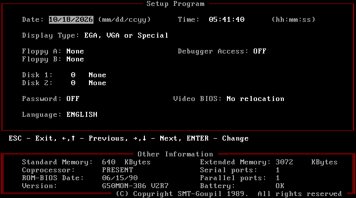</a>  [autre langue](G50/setup/G50_12P_V2R7_DD500Mo+G50_12N_V2R7_DD500Mo_langue.png) |
| G50 V3 DX VGA 33 MHz - G50MON-386 V3R7 `MG50.33.U14-A.BIN` + `MG50.33.U15-A.BIN` |  | <a href="G50/MG50.33.U14-A+MG50.33.U15-A_setup.png">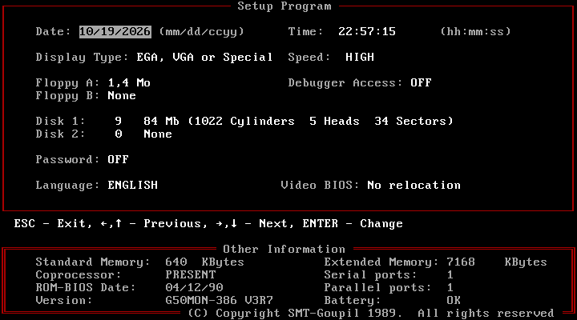</a>  [autre langue](G50/setup/MG50.33.U14-A+MG50.33.U15-A_langue.png) |

### G6

| BIOS | Démarrage | Setup |
|---|---|---|
| G6 SX / SX AC / DX / 486 - V1R1.4 `M3G6SX_V1R1.4.11H-2.BIN` (et `M3G6SX-AC.17J-2.BIN`, `M3G6DX.17L-2.BIN`, `M4G6-486.18K-2.BIN`, contenu identique) | <a href="G6/M3G6SX_V1R1.4.11H-2_demarrage.png">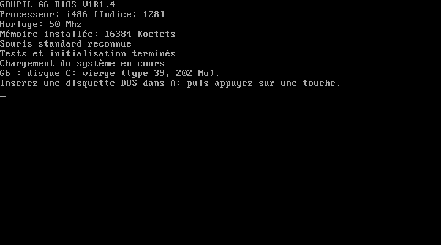</a> | <a href="G6/M3G6SX_V1R1.4.11H-2_setup.png">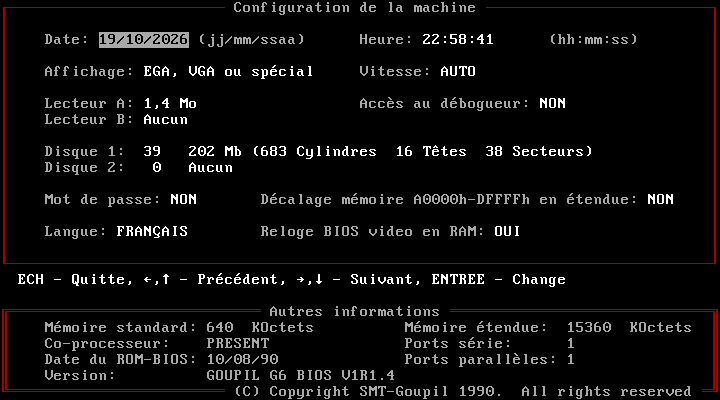</a>  [autre langue](G6/setup/M3G6SX_V1R1.4.11H-2_langue.png) |
| ISA32-B R2 (G6, Golf 486) `ISA32B-R2.BIN` | <a href="G6/ISA32B-R2_demarrage.png">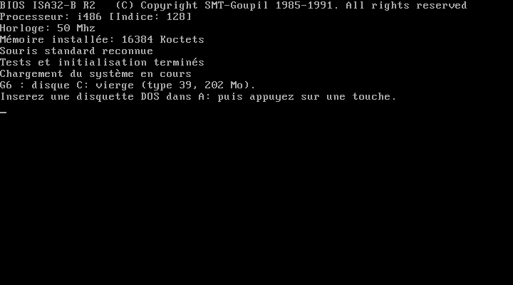</a> |   [autre langue](G6/setup/ISA32B-R2_langue.png) |
| ISA32-B R2.2 `ISA32BR2.2.BIN` |  | <a href="G6/ISA32BR2.2_setup.png">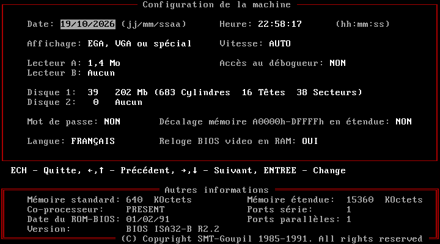</a>  [autre langue](G6/setup/ISA32BR2.2_langue.png) |
| ISA32-B R3.4 (proto) `ISA32B-R3.4.BIN` | <a href="G6/ISA32B-R3.4_demarrage.png">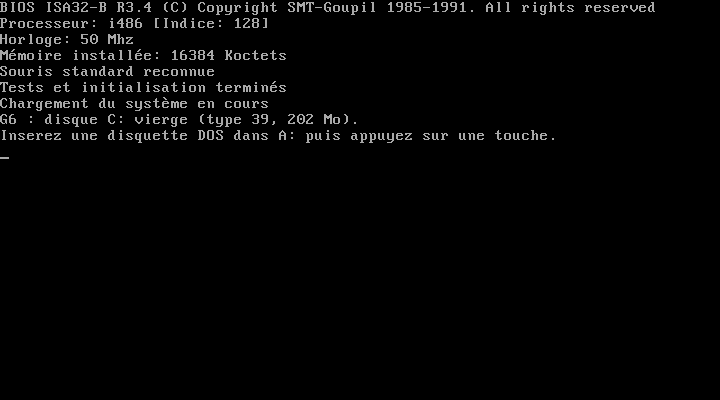</a> | <a href="G6/ISA32B-R3.4_setup.png">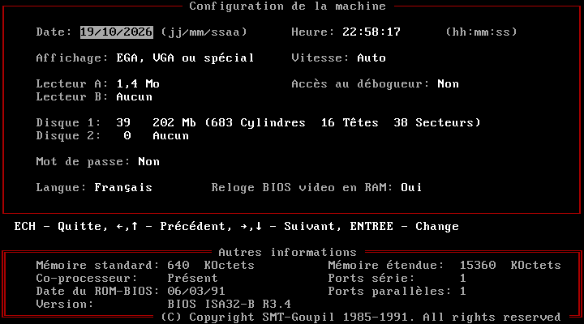</a>  [autre langue](G6/setup/ISA32B-R3.4_langue.png) |
| ISA32-B R2 modifié type 36 `ISA32B_R2_G6_SX_MODIF_TYPE36.BIN` |  | <a href="G6/ISA32B_R2_G6_SX_MODIF_TYPE36_setup.png">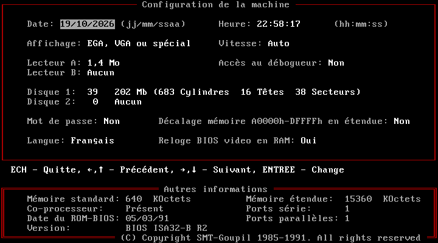</a>  [autre langue](G6/setup/ISA32B_R2_G6_SX_MODIF_TYPE36_langue.png) |
| ATON ISA-B R5.4 `G6ATON_ISA-B_R5.4.BIN` | <a href="G6/G6ATON_ISA-B_R5.4_demarrage.png">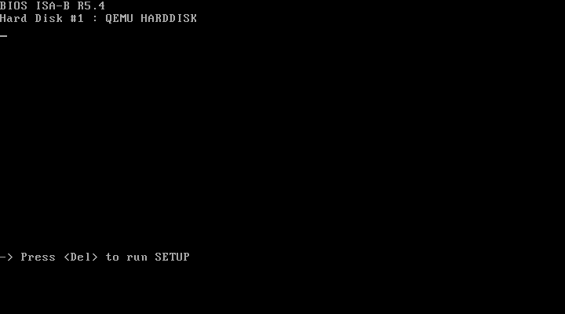</a> | <a href="G6/G6ATON_ISA-B_R5.4_setup.png">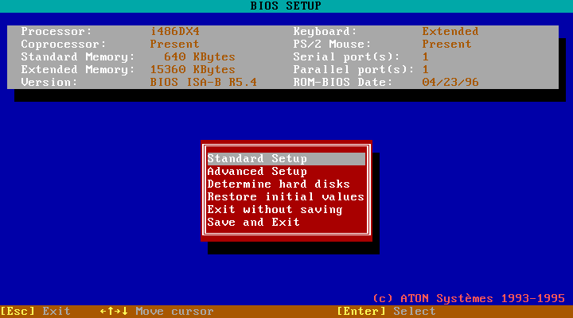</a>  [aide Boot from floppy](G6/setup/G6ATON_ISA-B_R5.4_aide_boot.png) · [aide Video Bios Shadow](G6/setup/G6ATON_ISA-B_R5.4_aide_shadow.png) · [aide Speed](G6/setup/G6ATON_ISA-B_R5.4_aide_vitesse.png) · [Advanced Setup](G6/setup/G6ATON_ISA-B_R5.4_avance.png) · [Determine hard disks](G6/setup/G6ATON_ISA-B_R5.4_disques.png) · [menu](G6/setup/G6ATON_ISA-B_R5.4_menu.png) · [Exit without saving](G6/setup/G6ATON_ISA-B_R5.4_quitter.png) · [Standard Setup](G6/setup/G6ATON_ISA-B_R5.4_standard.png) |

### G60

| BIOS | Démarrage | Setup |
|---|---|---|
| G60 EISA V1R3.1 (SMT) `G60.V1R3.1_SMT.BIN` |  |   [autre langue](G60/setup/G60.V1R3.1_SMT_langue.png) |
| G60 EISA-A R3.5 `G60-R3_5.BIN` |  |   [autre langue](G60/setup/G60-R3_5_langue.png) |
| G60 EISA-A R3.6 (ATON) `G60.EISA-AR3.6_ATON.BIN` |  |   [autre langue](G60/setup/G60.EISA-AR3.6_ATON_langue.png) |
| G60 EISA-A R3.9 (ATON) `G60.EISA-AR3.9_ATON.BIN` |  |   [autre langue](G60/setup/G60.EISA-AR3.9_ATON_langue.png) |

### G100

| BIOS | Démarrage | Setup |
|---|---|---|
| G100 V1R1 - G100MON-386 V1R1 `G100_M311-J10-A.BIN` + `G100_M311-J8-A.BIN` |  | — |
| G100 V1R2 - G100MON-386 V1R2 `G100_V1R2_L.H7.BIN` + `G100_V1R2_H.H5.BIN` |  | — |
| G100 V1R2.1 - G100MON-386 V1R2.1 `G100_V1R2.1_L.BIN` + `G100_V1R2.1_H.BIN` |  | — |

### Golf XT

| BIOS | Démarrage | Setup |
|---|---|---|
| Golf XT - GLMON-86 V1R3 `PGM-GL.10G-A.BIN` + `PGM-GL.10J-A.BIN` |  |  |

### Golf 286

| BIOS | Démarrage | Setup |
|---|---|---|
| Golf 286 - GLMON-286 V1R5.3 `M2GL.9K-1.BIN` + `M2GL.9M-1.BIN` |  |   [débogueur](Golf/286/setup/M2GL.9K-1+M2GL.9M-1_debug.png) · [disque dur](Golf/286/setup/M2GL.9K-1+M2GL.9M-1_disque.png) · [disquette](Golf/286/setup/M2GL.9K-1+M2GL.9M-1_disquette.png) · [type d'écran](Golf/286/setup/M2GL.9K-1+M2GL.9M-1_ecran.png) · [menu](Golf/286/setup/M2GL.9K-1+M2GL.9M-1_menu.png) |
| Golf 286 - GLMON-286 V1R6B `MG.1.9K-C_V1R6B.BIN` + `MG.1.9M-C_V1R6B.BIN` |  |   [autre langue](Golf/286/setup/MG.1.9K-C_V1R6B+MG.1.9M-C_V1R6B_langue.png) |
| Golf 286 - GLMON-286 V1R7 `MG.1.9K-D.BIN` + `MG.1.9M-D.BIN` |  |   [autre langue](Golf/286/setup/MG.1.9K-D+MG.1.9M-D_langue.png) |

### Golf SX

| BIOS | Démarrage | Setup |
|---|---|---|
| Golf SX - V1R6 `GOLF_SX_V1R6_11M.BIN` |  |   [autre langue](Golf/SX/setup/GOLF_SX_V1R6_11M_langue.png) |
| Golf SXC - V1R6 DGI `GOLF_SXC_V1R6_DGI.BIN` |  |   [autre langue](Golf/SX/setup/GOLF_SXC_V1R6_DGI_langue.png) |
| Golf SX - V1R7 `MGSX.1.11M-E.BIN` |  |   [autre langue](Golf/SX/setup/MGSX.1.11M-E_langue.png) |
| ISA32-A R2 (G5 / Golf SX) `ISA32A-R2.BIN` |  |   [autre langue](Golf/SX/setup/ISA32A-R2_langue.png) |
| ISA32-A R2 modifié disque 170 Mo `ISA32_A_R2_modif_disque170m.BIN` |  |   [autre langue](Golf/SX/setup/ISA32_A_R2_modif_disque170m_langue.png) |

### Strator

| BIOS | Démarrage | Setup |
|---|---|---|
| Strator - GLMON-86 V1R3 `GLMON-86.10G-A_STRATOR.BIN` + `GLMON-86.10J-A_STRATOR.BIN` |  | — |

### RAZ-PWR6

| BIOS | Démarrage | Setup |
|---|---|---|
| RAZ-PWR6 (effacement mot de passe) `RAZ-PWR6.BIN` |  | — |

## Goupil 2

Moniteur de la machine (`MON1` + `MON2`), invite `+`, et le générateur de caractères de la
carte vidéo.

| Moniteur | Police `VIDEO_G2_SMT` | Police `VIDEO_SMT_G2` |
|---|---|---|
|  |  |  |

## G3

Le G3 accepte plusieurs cartes processeur. Les moniteurs n'ont pas de setup : l'invite est `+`.

| Carte | Démarrage | Commandes |
|---|---|---|
| 8088 : G3MON-8088 V1R2 `UC88.1.6B-C.BIN`, `RAPR1.6B-C_G3_MON.BIN` + `RAPR1.5B-C_G3MON_8088_V1R2.BIN` |  |  H (liste des commandes), R (registres) |
| 6809 : G3MON-6809 V2R0 `UC09.2.1D-A_G3_6809.BIN` + `UC09.2.3D-A_G3_6809.BIN` |  |  R, T (table des pages), P, S, M (mémoire) |

Police de la carte de visualisation VISU (`VISU.1.1D-B.BIN`) : 

## Terminal GT220

Terminal des postes du G100 (`bios/G100/Terminal-GT220/`), trois versions du micrologiciel.

| Version | Accueil | Set-up |
|---|---|---|
| S1.5q (`GT220_S1_SR_*`) |  |  |
| S1.5n (`SMT_VS1_5N_*`) |  |  |
| T1.5b (`SMT_VT1_5B_*`) |  |  |

Les 11 menus de configuration de la version S1.5q, réglages d'usine : [I/O](G100/Terminal-GT220/GT220_S1.5q_menu_01_io.png) · [Emulation](G100/Terminal-GT220/GT220_S1.5q_menu_02_emulation.png) · [Mode](G100/Terminal-GT220/GT220_S1.5q_menu_03_mode.png) · [Display](G100/Terminal-GT220/GT220_S1.5q_menu_04_display.png) · [Attribute](G100/Terminal-GT220/GT220_S1.5q_menu_05_attribute.png) · [Keyboard](G100/Terminal-GT220/GT220_S1.5q_menu_06_keyboard.png) · [Tab](G100/Terminal-GT220/GT220_S1.5q_menu_07_tab.png) · [Printer](G100/Terminal-GT220/GT220_S1.5q_menu_08_printer.png) · [Program keys](G100/Terminal-GT220/GT220_S1.5q_menu_09_programkeys.png) · [General](G100/Terminal-GT220/GT220_S1.5q_menu_10_general.png) · [Save/Recall](G100/Terminal-GT220/GT220_S1.5q_menu_11_saverecall.png).

Police contenue dans la ROM : [S1.5q et S1.5n](G100/Terminal-GT220/GT220_S1.5q_police.png) (444 caractères 8×13 :
caractères de contrôle, ASCII, graphiques DEC, multinational, puis jeu PC),
[T1.5b](G100/Terminal-GT220/GT220_T1.5b_police.png) (449 caractères).

## SFENA 5090

Terminal compatible VT220, révision B5D (`bios/SFENA-5090/`). Sa police de caractères, sur une
puce à part, ne fait pas partie des dumps : ces écrans sont tracés avec une police de PC.

| | | |
|---|---|---|
|  autotest |  autotest réussi |  ligne d'état |
|  SET-UP, page SYSTEM |  SET-UP, page GENERAL |  SET-UP en français |

## Carte de test G16

ROM `G16TEST.BIN` (carte d'extension) et programme `G16TEST.EXE` de la disquette.

| Page d'accueil de la ROM dans un G6 | `G16TEST.EXE` sous MS-DOS | Déverminage en cours |
|---|---|---|
|  |  |  |

La ROM reconnaît la machine (`G16TEST #1.0B1 G6`) ; une minute après l'accueil, la séquence
de déverminage `b2` démarre seule.

## Polices de caractères

| ROM | Police |
|---|---|
| `Club/CLUB_U97A.BIN` |  format IBM : MDA 9×14, puis CGA 8×8 fine et épaisse |
| `Accessoires/Video-G4GA-V40GA/VGA_G4_4L-A_VIDEO_G4GA.BIN` |  carte G4GA du G4 et du G40 (V40GA), même format |

Les polices du G2, de la carte VISU du G3 et du terminal GT220 sont dans leurs sections.
