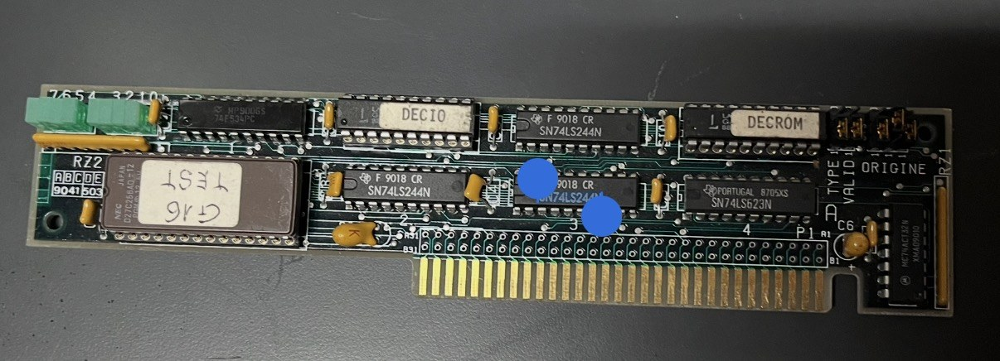
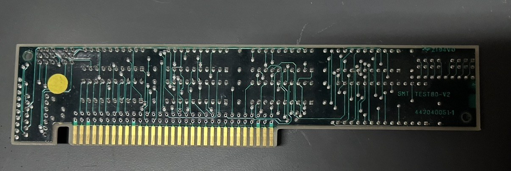
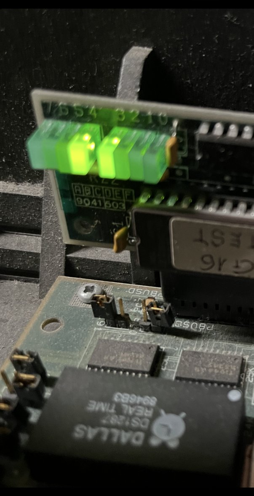

# Carte de test SMT TEST80-V2 et ROM G16 TEST

Carte de diagnostic ISA 8 bits de SMT-Goupil. Elle affiche sur 8 LED l'octet écrit sur le
**port 80h** et porte l'EPROM **G16 TEST**, une ROM d'extension de tests de production
(`bios/Accessoires/Carte-test-G16/G16TEST.BIN`, `G16TEST #1.0` du 03/09/90).

Cette fiche couvre les machines que G16 TEST reconnaît. Le décodage vient de la lecture du code
des BIOS du dépôt ; seule la lecture des LED (code `18h`, panne mémoire) a été confirmée sur une
machine réelle.

## La carte

| Repère | Rôle |
|---|---|
| `SMT TEST80-V2`, `447040051-1` | référence du circuit imprimé (côté soudures), grille de fabrication `9041 / 503` (semaine 41 de 1990) |
| 2 blocs de 4 LED vertes, sérigraphiés `7654` et `3210` | l'octet du port 80h, bit 7 à gauche, bit 0 à droite |
| `74F534` | verrou 8 bits qui mémorise l'octet écrit et commande les LED |
| PAL `DECIO` | décodage de l'adresse d'entrée-sortie, très probablement le port 80h |
| PAL `DECROM` | décodage de l'adresse de la ROM d'extension |
| `SN74LS244N` (×2), `SN74LS623N` | tampons et transceiver du bus de données |
| EPROM NEC 27C256, étiquette « G16 TEST » | la ROM G16 TEST |
| cavaliers `TYPE`, `VALID`, `ORIGINE` | rôle non déterminé (probablement validation et adresse de la ROM) |

## Lire les LED

Les 8 LED forment **un seul octet**, à lire en hexadécimal. Une LED allumée vaut 1 :

- groupe de gauche, LED 7 6 5 4 (poids 8 4 2 1) : chiffre de gauche ;
- groupe de droite, LED 3 2 1 0 (poids 8 4 2 1) : chiffre de droite.

Exemple : LED 4 et 3 allumées → `0001 1000` → **18h**.

Deux programmes écrivent cet octet, l'un après l'autre :

1. le **BIOS**, pendant le POST : l'octet est le numéro de l'étape en cours ;
2. **G16 TEST**, lancé par le BIOS vers la fin du POST : l'octet devient un jeu de drapeaux,
   une LED par famille de tests en erreur.

Le code qui compte est celui où l'affichage **reste figé**.

## Machines reconnues par G16 TEST

G16 TEST identifie la machine par la chaîne du BIOS. Les BIOS correspondants du dépôt se rangent
en quatre familles selon l'usage qu'ils font du port 80h.

| Machine (nom dans G16 TEST) | BIOS | Famille |
|---|---|---|
| Club (`CLUB`) | G4MON-88 | **D** : n'écrit pas sur le port 80h |
| G4 V1, G4 V2 (`G4_V1`, `G4_V2`) | G4MON-186 | **D** |
| G5 S86 (`XG5-S86`) | G5MON-86 V1R3, V2R3 | **A** : 8086, 24 étapes |
| Golf 86 (`GOLF86`) | GLMON-86 V1R3 | **A** |
| G40 (`G40`) | G4MON-286 V1R3, V2R5 | **B** : 286/386, 23 étapes |
| G5 286 (`G5-286`) | G5MON-286 V1R2, V1R4.2, V1R5, V2R4, V2R5, V3R5 | **B** |
| | G5MON-286 V3R6, V3R7, V4R7 | **C** : 286/386, 22 étapes |
| Golf 286 (`GOLF`) | GLMON-286 V1R5.3 | **B** |
| | GLMON-286 V1R6B, V1R7 | **C** |
| G5 386 (`G5-386`) | G5MON-386 V1R4 | **B** |
| | G5MON-386 V2R6, V1R7 | **C** |
| G5 386 DX (`G5-DX`) | G5MON-386C V1R7 | **C** |
| G5 SX (`G5-SX`) | G5MON-SXC V1R7 | **C** |
| Golf SX (`GOLFSX`) | GLMON-SX V1R6, V1R7 ; G5MON-SXC V1R6B DGI | **C** |
| G50 (`G50`) | G50MON-386 V1R5, V1R5B, V2R5 | **B** |
| | G50MON-386 V2R6, V2R6B, V2R7, V3R7 | **C** |
| G6 (`G6`) | GOUPIL G6 BIOS V1R1.4 | **C** |

G16 TEST reconnaît aussi les BIOS `VCMON-86`, `VCMON-286` et `VCMON-386`, absents du dépôt et
donc non analysés.

Sur les machines de la famille **D**, les LED ne suivent pas le démarrage : leur état au départ
est quelconque, et seul G16 TEST les fait réagir.

## Codes du POST (familles A, B, C)

Les trois familles partagent le même mécanisme : un répartiteur appelle les étapes d'une table,
dans l'ordre, et écrit `4 × n` sur le port 80h avant l'étape *n*. Certaines étapes ajoutent 1 à
chaque sous-étape. Donc :

- **LED 7 à 2** : numéro de l'étape ;
- **LED 1 et 0** : sous-étape.

La colonne « Bips » indique les étapes qui arrêtent la machine sur une erreur (voir plus bas).
Le découpage diffère seulement à partir de `34h`.

| Code | Bips | A (8086) | B (23 étapes) | C (22 étapes) |
|---|---|---|---|---|
| `00` | – | initialisation, lecture de la CMOS | idem | idem |
| `04` | – | coupure de la vidéo | idem | idem |
| `08` | 2 longs | somme de contrôle de la ROM du BIOS | idem | idem |
| `0C` | 3 longs | lignes de données de la CMOS (écriture puis relecture) | idem | idem |
| `10`, `11` | 4 longs (+1 court) | timer 8254, compteur 1 (rafraîchissement) : ne compte pas, reste bloqué | idem | idem |
| `14`-`17` | 5 longs (+0 à 3 courts) | contrôleur DMA 8237 (`14`, `15`) | DMA n° 1, DMA n° 2, registres de page, bit de rafraîchissement du port `61h` | idem B |
| `18` | 6 longs | **64 premiers Ko de RAM** | idem | idem |
| `1C` | – | contrôleur d'interruptions 8259 | pile en RAM, vecteurs d'interruption | idem B |
| `20`-`22` | B, C : 8 longs (+1 court) | ports `61h`/`62h` (parité, NMI) | contrôleur clavier 8042 : `20` pas de réponse, `21` autotest ; `22` étape suivante | idem B |
| `24` | – | recherche de la ROM vidéo, type d'écran | idem | idem |
| `28` | – | interruption inattendue | idem ; l'affichage repasse à `00` pendant la fin de l'étape | idem B |
| `2C` | – | timer 0 et IRQ 0 | idem | idem |
| `30`-`33` | – | test et dimensionnement de la mémoire | idem | idem |
| `34` | – | (étape vide) | compte rendu du test mémoire (erreur de parité) | idem B |
| `38` | – | clavier | affichage de la taille mémoire | vecteurs d'interruption (G6 : affichage du processeur) |
| `3C` | – | affichage de la taille mémoire | vecteurs d'interruption | clavier (G6 : horloge, clavier) |
| `40` | – | vecteurs d'interruption | clavier | affichage de la taille mémoire |
| `44` | – | disquettes et disques durs (`INT 13h`) | idem | idem |
| `48` | – | état de la CMOS, messages d'erreur | idem | idem |
| `4C` | – | ROM d'extension en `C8000h` et au-delà, **dont G16 TEST** | idem | idem |
| `50` | – | effacement de la zone de travail | idem | idem |
| `54` | – | coprocesseur, octet d'équipement | idem | idem |
| `58` | – | ROM en `E0000h` | ROM en `E0000h` | invite de configuration, mot de passe, amorçage |
| `5C` | – | invite de configuration, amorçage | idem A | – |

Avant l'amorçage, la dernière étape écrit `00` : après un démarrage normal, l'affichage est à
`00`, sauf si G16 TEST a pris la main.

Les intitulés des étapes à bips viennent des tests eux-mêmes. Les autres sont déduits des ports
utilisés et des messages affichés : ils peuvent varier d'une version à l'autre.

### Autres codes (familles B et C)

- **`91h` et au-delà** : exception du processeur en mode protégé pendant le test mémoire. Le
  gestionnaire écrit `91h` + numéro du vecteur puis arrête le processeur (`9Eh` = vecteur 13,
  faute de protection générale).
- **`01` à `03` sous DOS** : les copies vers la mémoire étendue (`INT 15h AH=87h`, utilisée par
  HIMEM ou un disque virtuel) réutilisent le port 80h ; `01` signale une erreur de parité.

## Bips d'erreur (familles A, B, C)

Une étape qui échoue avant que l'écran ne fonctionne appelle une routine commune, sans pile ni
vidéo, qui joue le code au haut-parleur (environ 880 Hz) :

- **bips longs** = code ÷ 4, le numéro de l'étape (LED 7 à 2) ;
- **bips courts** = code modulo 4, la sous-étape (LED 1 et 0) ;
- puis le processeur s'arrête : il faut éteindre la machine.

Les durées sont comptées par boucles logicielles : plus le processeur est rapide, plus les bips
sont brefs. Les deux groupes se distinguent par la longueur des bips plutôt que par une pause.

Sur les familles B et C, 8 bips longs (code `20h`) peuvent aussi venir d'un redémarrage du
processeur avec le code d'arrêt CMOS `08h`, un cas anormal. Avec une pile morte, une valeur
parasite dans le registre `0Fh` de la CMOS peut le provoquer.

Un bip aigu isolé n'est pas une erreur : tampon clavier plein ou caractère « cloche » affiché.

## Pendant G16 TEST

G16 TEST affiche `G16TEST #1.0` et l'invite `Command:`. Il range l'octet du port 80h en
`[0146h]` de sa zone de données, à `80h` au départ, et y ajoute un bit à chaque erreur. La table
de correspondance est en `0x7067` de la ROM : 11 entrées de 3 octets (n° de test, sous-test,
bit) ; un sous-test à 0 couvre tout le test.

| LED | Sens dans G16 TEST |
|---|---|
| 7 | allumée en permanence : G16 TEST tourne |
| 6 | jamais utilisée |
| 5 | test 6 : CMOS (horloge, alarme, interruption périodique, mémoire, pile) |
| 4 | test 5 : port série n° 2 ; sous-test 2c : interruption 3 (2e port série, ou souris sur Golf et G5) |
| 3 | test 4 : port série n° 1 ; sous-test 2d : interruption 4 |
| 2 | test 3 : port parallèle (registres, liaison avec bouchon, haut-parleur) ; sous-test 2f : interruption 7 |
| 1 | sous-tests 2a, 2b, 2e : registre de masque du 8259, interruption du timer (IRQ 0), du contrôleur de disquette (IRQ 6) |
| 0 | test 1 : mémoire (taille, bus de données et d'adresses, rafraîchissement, parité, transferts, cache) |

Les tests 7 à 13 (disquettes, disques durs, coprocesseur, vidéo, souris InPort) n'ont pas de
LED : leurs erreurs ne s'affichent qu'à l'écran.

Fonctionnement :

- les erreurs s'additionnent et restent allumées : LED 7 + 0 + 3 = erreur mémoire et erreur
  sur le port série n° 1 ;
- à chaque erreur, toutes les LED s'éteignent un instant puis se rallument : c'est le
  clignotement visible ;
- pendant le test de la mémoire étendue, le programme passe en mode protégé (tout allumé,
  `FFh`) et en revient par une réinitialisation du processeur (tout éteint, `00`) : flashes
  rapides normaux ;
- la commande `r` (Reset) remet l'affichage à `80h` ;
- en quittant sans erreur vers DOS, le programme écrit `00`.

L'affectation des sous-tests du test 2 suppose que les sous-tests a à f sont numérotés de 1 à 6
dans la table. Elle est cohérente avec les familles (l'interruption du 2e port série tombe sur
la LED du port série n° 2, celle du port parallèle sur la LED du port parallèle) mais n'a pas
été vérifiée sur la carte.

## Exemple réel

Machine qui ne démarre plus, écran noir, affichage figé sur LED 4 et 3 (photo ci-dessus) : code
`18h`, test des 64 premiers Ko de RAM. La panne venait bien d'une barrette mémoire.

Pistes pour ce code : nettoyer les contacts et réinsérer les barrettes de la première banque,
en essayer d'autres, vérifier qu'il s'agit de barrettes **avec parité** (le test contrôle aussi
les erreurs de parité).
